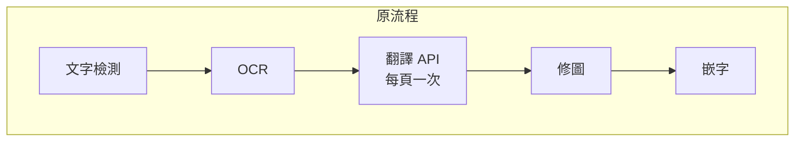
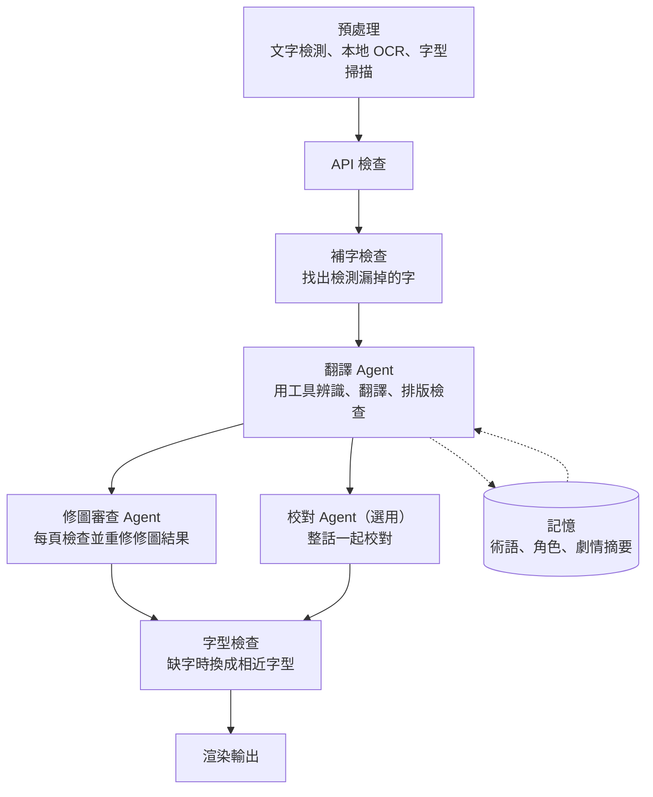
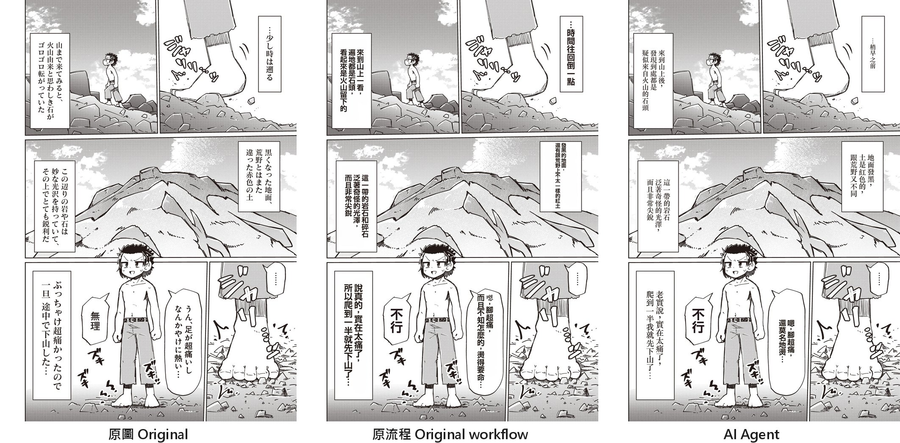
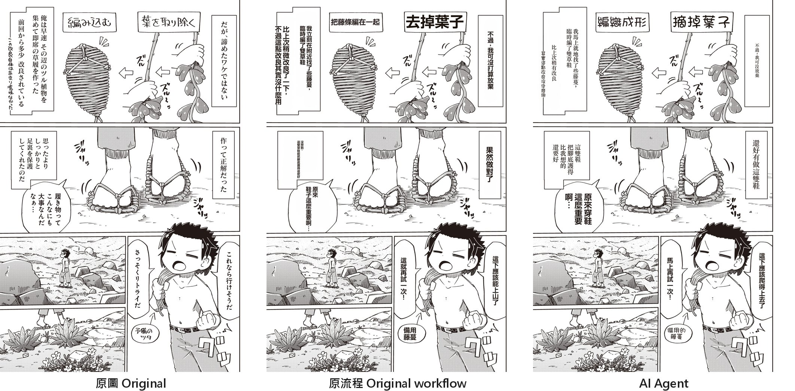
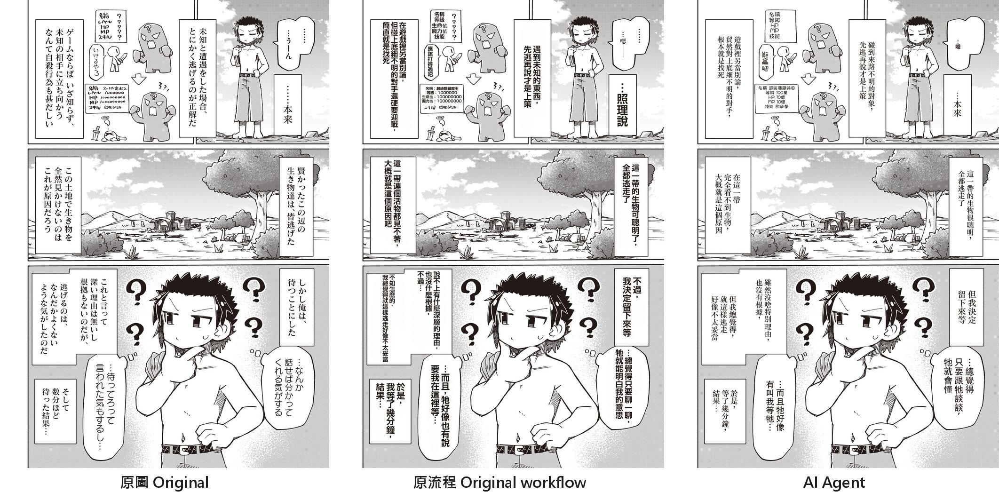
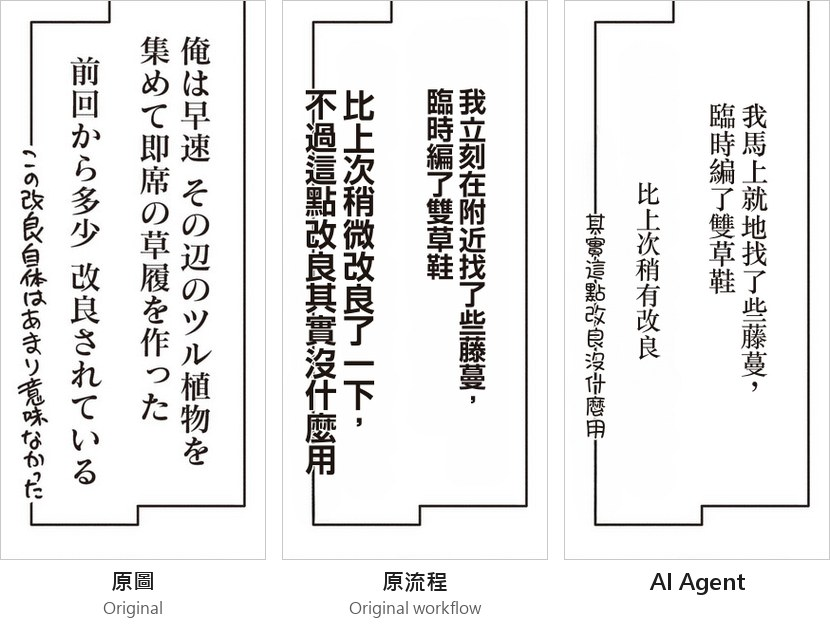
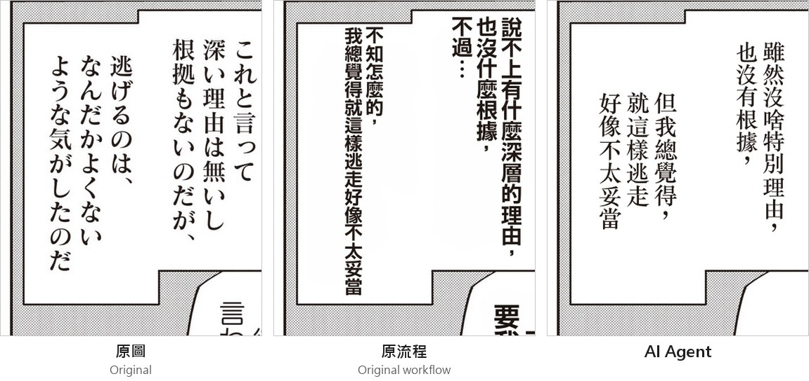
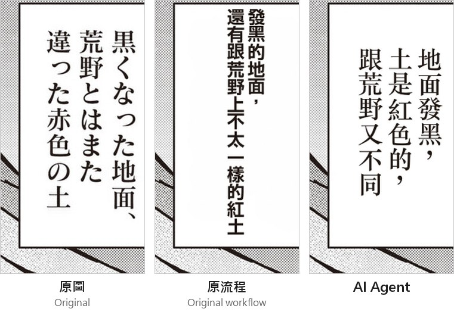
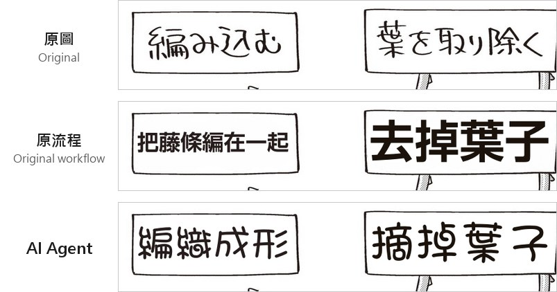
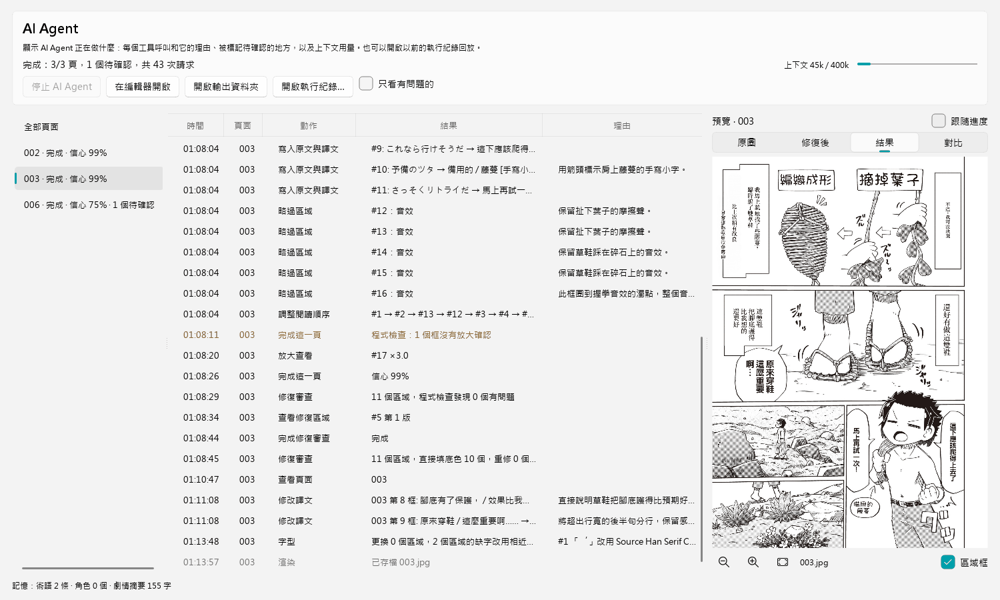

<div align="center">

# Manga Translator UI — AI Agent 分支

**讓 AI Agent 像譯者一樣逐頁看圖、翻譯、檢查，再交給程式修圖和嵌字**

[](https://github.com/hgmzhn/manga-translator-ui)
[](LICENSE.txt)

**語言 / Language**：繁體中文 | [English](README_EN.md)

</div>

這是 [hgmzhn/manga-translator-ui](https://github.com/hgmzhn/manga-translator-ui) 的 fork。`agents`
分支在原本的翻譯流程旁邊加了一個 **AI Agent 流程**：一個會用工具的視覺語言模型逐頁讀圖、補上漏掉的字、
翻譯、檢查排版，另外幾個子 Agent 負責檢查修圖和校對；像素的工作（檢測、修圖、嵌字）仍然由程式完成。
這個分支也合併了幾個上游尚未合併的 PR，並修了一些問題（見[其他修改](#其他修改)）。

> **注意：** 這個分支由個人維護，不是上游的官方版本。AI Agent 流程相關的問題請不要回報到上游專案。

## 重點摘要

先看結論，再看細節：

- **效果：** 同樣三頁、同一個模型，AI Agent 會把擠在一起的旁註拆開、保留段落、讓窄框裡的字仍然看得清楚，
  並替招牌和手寫字挑接近原作的字型。[看對比圖](#對比原流程與-ai-agent)
- **成本：** AI Agent 每頁約用 32 萬提示 token（八成以上命中快取）和 4 千輸出 token，大約是原流程的 12 倍費用。
  [看 token 用量](#token-用量時間與費用)
- **時間：** 實際章節每頁約 2 到 2.5 分鐘；原流程三頁約 77 秒。
- **人工確認：** Agent 沒把握的地方會列進待確認清單，在 AI Agent 頁面和編輯器裡都看得到。

## 對比：原流程與 AI Agent

下面三張圖都用同一份程式版本、同一個 OpenAI 相容 API 上的同一個 GPT 系列視覺模型、同一份作品提示檔（術語表）重新跑出來。
原流程使用高品質翻譯器，每頁一次請求；AI Agent 使用預設設定並開啟校對。每張圖由左到右是原圖、原流程、AI Agent。

> 圖片取自一部日文商業漫畫的三頁，版權歸原作者所有，只用來說明翻譯效果。

### 流程差異

原流程把整頁文字一次送給翻譯 API，拿回譯文後直接修圖和嵌字。AI Agent 流程則讓模型用工具一步一步處理每一頁，
每一步都有紀錄，程式也會在每一步檢查結果。





### 整頁對比

**第 2 頁：** 右上的窄框，原流程把兩句擠成很小的字；AI Agent 依原文的分行排成三行。旁白也改用接近原作的明體，
對話仍用粗黑體。



**第 3 頁：** 左上的旁白和旁邊的小字旁註，原流程把它們合成一塊；AI Agent 拆成兩個框，旁註用小一號的手寫風字型。
招牌字也換成手寫風字型。不過右上「不過，我可沒放棄」在細長框裡排得偏小，這是 AI Agent 這次的缺點。



**第 6 頁：** 左下的旁白原本有兩段，原流程把第二段擠成一行小字；AI Agent 保留兩段，字級一致。



### 細節放大

以下是同一個區域放大後的比較。兩種流程都保留了畫在圖上的狀聲詞，沒有亂改。

| 旁白和旁註分開 | 兩段旁白分開 |
| :---: | :---: |
|  |  |

| 窄框裡的字 | 招牌字型 |
| :---: | :---: |
|  |  |

## AI Agent 怎麼運作

AI Agent 流程把「看懂和決定」交給模型，把「算像素」留給程式。模型透過工具讀取和修改每一頁的資料，
程式負責檢查模型的每一步，並把結果寫回和原流程相同的 `*_translations.json`，所以編輯器可以照常開啟和修改。

### 各個 Agent

一個章節（一個資料夾）會依序經過下面幾個角色。補字檢查和修圖審查會和翻譯 Agent 同時進行，以節省時間。

| 角色 | 做什麼 | 預設 |
| --- | --- | --- |
| 補字檢查 | 每頁開始前，另外請模型找出文字檢測漏掉的字（手寫、小字、框外的字），吸附到筆畫後加成新的區域。下一頁的檢查會在翻譯 Agent 處理目前這頁時先跑。 | 開啟 |
| 翻譯 Agent | 看整頁圖和候選區域，必要時放大小字或手寫字再讀一次，寫下原文和譯文、分行、閱讀順序，合併或拆開區域，略過狀聲詞，並記錄術語、角色和劇情摘要。 | 開啟 |
| 修圖審查 Agent | 每頁一段獨立對話。先由程式檢查修圖結果（有沒有殘字、線條斷掉、改到遮罩外），平坦背景的框直接填紙色；有問題的區域由模型調整遮罩、保護線條、重修，最多重試 3 次。 | 開啟 |
| 校對 Agent | 翻譯完成後，一次看完整話的譯文，只修真的有錯的地方。 | 關閉 |
| 字型 | 翻譯 Agent 可以替旁白、手寫字、招牌選一個接近原作的已安裝字型；最後程式會把缺字的框換成最相近、而且字都齊全的字型，換之前會先實際渲染比較，會讓文字移位或變大小的替換不做。 | 開啟 |

### 翻譯 Agent 的工具

翻譯 Agent 每一步都要呼叫工具，不能直接回一段文字了事。主要的工具如下：

- **看圖：** `get_candidates`（編號過的整頁圖和區域清單）、`zoom`（放大並加上 A1–H8 格線）、`get_neighbors`（前後頁縮圖）、`local_ocr`、`measure_bubble`。
- **改區域：** `add_region`、`merge_regions`、`split_region`、`skip_region`、`set_reading_order`、`link_regions`。
- **寫譯文：** `set_text`、`set_line_breaks`、`set_font_style`。
- **記憶：** `glossary_search`、`glossary_upsert`、`character_get`、`character_upsert`、`story_summary_get`、`story_summary_update`、`search_past_translations`。
- **收尾：** `flag_for_review`（列進待確認清單）、`mark_page_done`、`budget_status`、`undo`。

`mark_page_done` 會先跑程式檢查（例如有沒有框沒譯、小字或手寫字沒放大確認、譯文和術語表不一致），
並依檢查結果算出這一頁的信心值。信心低於 0.7 的頁會進入待確認清單。

### 記憶與作品提示檔

翻譯 Agent 會記下術語、角色（譯名、性別、說話方式）和劇情摘要。同一部作品的各話共用這份記憶：
一話第一次執行時會帶著前面各話學到的東西開始，結束時再把自己的部分加進去。

如果你在翻譯設定裡指定了作品提示檔（`translator.high_quality_prompt_path`，例如 `dict/<作品>.yaml`），
它的說明和術語表會放進 Agent 的系統提示，程式也會檢查譯文有沒有照術語表翻。每話結束後，
Agent 新記下而且真的用在譯文裡的名字和術語會加進這份提示檔；既有的條目不會被改，你原本的檔案會留一份 `.bak`。

### 上下文管理

一段對話最多 40 萬 token。請求超過 30 萬 token 時，會在下一頁開始前壓縮對話；較舊的頁只保留文字，
最近 5 頁才保留圖片。整頁圖片最長邊會縮到 2048 px（放大的局部圖不縮）。每段對話都有自己的
`prompt_cache_key`，讓 API 盡量命中快取；回覆用串流接收，所以會在一段時間沒有資料時切斷連線的代理也不會中斷長回覆。

## Token 用量、時間與費用

這一節的數字都來自實際執行的紀錄（`manga_translator_work/agent/runs/*.jsonl` 和 API 回報的用量）。
「提示 token」包含命中快取的部分；快取通常以較低的價格計費。

### 同樣三頁的對比

下表是上面三張對比圖的那次執行（3 頁，33 個區域）。

| | 原流程 | AI Agent |
| --- | ---: | ---: |
| 請求次數 | 3 | 43 |
| 提示 token | 38,264 | 972,725 |
| 其中命中快取 | 21,120（55%） | 805,889（83%） |
| 輸出 token | 1,201 | 12,290 |
| 每頁提示 token | 約 12,800 | 約 324,000 |
| 每頁未快取提示 token | 約 5,700 | 約 55,600 |
| 每頁輸出 token | 約 400 | 約 4,100 |
| 時間 | 77 秒（含載入模型） | 8.9 分鐘（含預處理） |

第 2 頁的修圖審查第一次因為電腦記憶體不足失敗，事後用「補做」重跑，多用了 2 次請求（約 1.5 萬提示 token），沒有算在上表。

AI Agent 每頁的提示 token 依角色分配如下：

| 角色 | 每頁提示 token | 佔比 |
| --- | ---: | ---: |
| 翻譯 Agent | 約 190,600 | 59% |
| 修圖審查 Agent | 約 103,400 | 32% |
| 校對 Agent | 約 21,600 | 7% |
| 補字檢查 | 約 8,600 | 3% |

### 實際章節的平均

下表是 8 次完整章節執行（共 90 頁）的平均，其中部分章節開啟了校對。這些執行是在整頁圖片縮到 2048 px 之前跑的。

| 項目 | 每頁 |
| --- | ---: |
| 請求次數 | 12.5 |
| 提示 token | 426,105 |
| 命中快取 | 89% |
| 未快取提示 token | 48,412 |
| 輸出 token | 2,867 |
| 時間（單獨執行時） | 約 2–2.5 分鐘 |

提示 token 的分配：翻譯 Agent 75%（每頁 5.3 次請求，94% 命中快取）、修圖審查 19%（每頁 5.8 次請求，76% 命中快取）、
校對 4%、補字檢查 2%。

### 費用估算

費用可以這樣算：

```text
每頁費用 = 未快取提示 token × 輸入單價
         + 命中快取的提示 token × 快取單價
         + 輸出 token × 輸出單價
```

下面用**假設的單價**示範：輸入每百萬 token 2 美元、快取每百萬 token 0.2 美元、輸出每百萬 token 8 美元。
請換成你實際使用的模型和服務商的價格。

| | 原流程 | AI Agent（三頁對比） | AI Agent（90 頁平均） |
| --- | ---: | ---: | ---: |
| 每頁費用 | 約 $0.016 | 約 $0.20 | 約 $0.20 |
| 一話 12 頁 | 約 $0.19 | 約 $2.4 | 約 $2.3 |

> **注意：** 費用高度依賴快取。如果你的 API 不支援提示快取，AI Agent 每頁的提示 token 全部以原價計算，
> 用上面的假設單價大約是每頁 $0.68。

### 降低用量

下面這些設定都在 **設定 → AI Agent** 分頁裡，可以依需要調整：

- **校對**（`proofread`）預設關閉；開啟後約多 4–7% 的提示 token。
- **修圖審查**（`inpaint_review`）佔 19–32%；關閉後改用原本的修圖結果，不會再檢查和重修。
- **補字檢查**（`recall_pass`）只佔 2–3%，但能補上檢測漏掉的字，建議保留。
- **放大重讀**（`double_read`）設成 `none` 可以少放大幾次，但小字和手寫字比較容易讀錯。
- **圖片細節**（`image_detail`）設成 `low` 可以大幅減少圖片 token，但小字很難讀清楚。
- **保留圖片的頁數**（`keep_images_last_n_pages`）調小，每次請求會比較小。

## 使用方式

這一節說明怎麼在圖形介面和命令列使用 AI Agent 流程，以及怎麼處理結果。

### 需求

AI Agent 需要一個 **OpenAI 相容、支援圖片輸入和工具呼叫（function calling）** 的 API。
這個分支只用 GPT 系列的視覺模型實測過；支援提示快取的 API 會便宜很多。

AI Agent 和 OpenAI 翻譯器共用同一組 API 設定（`OPENAI_API_KEY`、`OPENAI_API_BASE`、`OPENAI_MODEL`，
以及它們的編號候選），所以 API 輪替也會套用。要讓 Agent 用不同的模型，可以在 **設定 → AI Agent** 填入模型名稱。

### 在圖形介面使用

依照下面的步驟開始一次 AI Agent 翻譯：

1. 在 **設定** 裡設定 OpenAI 相容的 API，並視需要指定作品提示檔。
2. 在 **翻譯** 頁的 **翻譯流程模式** 選 **AI Agent 流程**。
3. 加入要翻譯的章節資料夾，按 **開始 AI Agent 流程**。
4. 在 **AI Agent** 頁面查看進度：每個工具呼叫和它的理由、待確認的地方、上下文用量，以及修圖前後的預覽。
5. 完成後按 **在編輯器開啟**。編輯器的 **AI Agent** 分頁會列出這一頁的待確認項目、略過的框和修圖區域；
   選一項就會在編輯器選取那個框。略過的框可以用 **恢復這個框** 加回頁面，修圖區域可以用 **改用這一版** 換成其他次的修圖結果。



AI Agent 頁面也可以用 **開啟執行紀錄** 回放以前的執行。

### 再跑一次同一話

對已經跑過 AI Agent 的章節再按開始時，程式會先詢問要怎麼處理：

| 選項 | 做什麼 |
| --- | --- |
| 補做沒做成的步驟 | 只重跑上次失敗的步驟（例如 API 用量用盡時沒做成的修圖審查或校對），再重新渲染這些頁。 |
| 重新檢查 | 不重新檢測也不重翻，保留現有譯文，用目前的規則把完成的頁再看一遍，只重新修圖有變動的地方。你在編輯器改過的框會被鎖住。 |
| 只處理沒完成的 | 已完成的頁和在別處翻好的頁都不動。 |
| 全部重跑 | 每一頁重新檢測、重翻，覆寫譯文和 JSON。 |

覆寫之前，程式會把 JSON、修圖結果和輸出圖備份到 `manga_translator_work/agent/backups/`。
中途停止或失敗時，還沒做完的頁會還原成執行前的樣子。

### 在命令列使用

在設定檔裡把 `cli.agent_workflow` 設成 `true`，`local` 模式就會走 AI Agent 流程：

```bash
python -m manga_translator local -i <章節資料夾> --config <設定檔.json>
```

另外有兩個參數可以處理已經跑過的章節（即使 `cli.agent_workflow` 關閉也會走 AI Agent，不支援 `--subprocess`）：

- `--agent-revise`：重新檢查，等同圖形介面的「重新檢查」。
- `--agent-redo`：補做上次沒做成的步驟。

### 主要設定

所有設定都在設定檔的 `agent` 區段，常用的也都在 **設定 → AI Agent** 分頁裡。

| 設定 | 預設 | 說明 |
| --- | --- | --- |
| `model` | 空白 | Agent 用的模型；空白時用 `OPENAI_MODEL`。 |
| `reasoning_effort` / `review_reasoning_effort` | 空白 | 翻譯和校對／補字和修圖審查的推理強度；空白時不送，用模型預設。 |
| `max_context_tokens` | 400000 | 一段對話的上限。 |
| `compact_threshold_tokens` | 300000 | 超過這個大小就在下一頁前壓縮對話。 |
| `keep_images_last_n_pages` | 5 | 保留圖片的最近頁數。 |
| `page_image_max_side` | 2048 | 整頁圖片的最長邊；0 表示原尺寸。 |
| `max_steps_per_page` | 40 | 每頁最多幾次模型呼叫。 |
| `image_detail` | `high` | 圖片細節：`high` 或 `low`。 |
| `double_read` | `small_or_handwritten` | 哪些區域要放大重讀：`all`、`small_or_handwritten`、`none`。 |
| `recall_pass` | `true` | 補字檢查。 |
| `inpaint_review` | `true` | 修圖審查。 |
| `fill_flat_areas` | `true` | 平坦背景的框直接填紙色。 |
| `proofread` | `false` | 校對整話。 |
| `choose_fonts` / `fix_missing_glyphs` | `true` | Agent 選字型／缺字換字型。 |
| `low_confidence_threshold` | 0.7 | 信心低於這個值的頁進入待確認清單。 |
| `stream_requests` | `true` | 用串流接收回覆。 |
| `share_memory` | `true` | 同一部作品的各話共用記憶。 |
| `update_work_glossary` | `true` | 把新術語寫回作品提示檔。 |
| `revise_lock_user_edits` | `true` | 重新檢查時鎖住你在編輯器改過的框。 |
| `extra_instructions` | 空白 | 加在系統提示後面的額外指示。 |

## 限制

AI Agent 流程不是萬能的。使用前請先了解這些限制：

- **費用和時間：** 每頁的 token 用量約是原流程的 25 倍，費用約 12 倍（有快取時），時間也長很多。
- **仍需人工確認：** Agent 會出錯，例如把短句排得太小。請看過待確認清單和成品再發布。
- **模型品質：** 結果高度依賴模型的視覺和工具呼叫能力。只在 GPT 系列視覺模型上實測過。
- **API 用量上限：** 用量用盡時，該頁會先用現有的結果渲染，並記下沒做成的步驟，之後可以用「補做」或 `--agent-redo` 重跑。
- **記憶體：** 修圖審查會在本機產生多個修圖候選，記憶體不足時可能失敗（同樣可以補做）。

## 其他修改

除了 AI Agent 流程，這個分支還有下面這些修改。

**合併的上游 PR（尚未在上游合併）：**

- [#297](https://github.com/hgmzhn/manga-translator-ui/pull/297)：PP-OCRv6 Manga v0.2 文字檢測器（pipi9178）。
- [#320](https://github.com/hgmzhn/manga-translator-ui/pull/320)：貼上區域樣式時一併複製描邊設定（jscmp4）。
- [#334](https://github.com/hgmzhn/manga-translator-ui/pull/334)、[#335](https://github.com/hgmzhn/manga-translator-ui/pull/335)：編輯器富文本與筆刷大小的修正（LevKno）。
- [#338](https://github.com/hgmzhn/manga-translator-ui/pull/338)、[#339](https://github.com/hgmzhn/manga-translator-ui/pull/339)、[#340](https://github.com/hgmzhn/manga-translator-ui/pull/340)：API 測試、串流譯文與直排斷行標點的修正（sansenjian）。

**效能與修正：**

- 修正較慢的 cuDNN 路徑、恢復 OpenCV 執行緒，分格偵測改在記憶體中進行。
- API OCR 空白框不再無限重試；編輯器的 YAML 提示檔和失控的文字畫布修正。
- 檔名相同、副檔名不同的頁各有自己的工作檔和輸出圖；匯出不會覆蓋原圖。
- 重新匯入同一個壓縮檔時保留各頁的工作；有文字或多張圖片的 PDF 頁會整頁渲染。
- 命令列 `--subprocess` 模式保留章節資料夾，並遵守記憶體上限。

**介面：**

- 繁體中文介面用語整理成台灣用語。
- 編輯器在離開、關閉程式或移除圖片之前，會依設定先儲存並匯出目前這一頁；儲存前如果檔案被其他程式改過，會先詢問。
- 程式在其他分支或有本地提交時，內建更新不會把它切回上游的 `main`。

## 安裝

這個分支沿用上游的安裝方式，只是程式碼要切到 `agents` 分支。AI Agent 流程不需要額外的 Python 套件。

1. 依照[上游的說明](https://github.com/hgmzhn/manga-translator-ui#-快速开始)安裝（例如 Windows 便攜安裝包），確認可以正常啟動。
2. 在程式資料夾裡切到這個分支（Windows 便攜包可以用資料夾裡的 `PortableGit\cmd\git.exe` 代替 `git`）：

   ```bash
   git remote add agents https://github.com/HHim8826/manga-translator-ui-agent.git
   git fetch agents
   git checkout -B agents agents/agents
   ```

3. 照常啟動程式。

之後要更新時，在同一個資料夾執行 `git pull agents agents`。

> **警告：** 不要使用程式內建的「立即更新」或安裝選單的更新，它們是為上游的 `main` 設計的。
> 這個分支已經加了保護，在其他分支上不會直接覆蓋，但用 `git pull` 更新最安全。

## 致謝

這個分支建立在許多專案和貢獻者的成果上：

- [hgmzhn/manga-translator-ui](https://github.com/hgmzhn/manga-translator-ui)：上游專案，包含介面、編輯器和完整的翻譯流程。
- [zyddnys/manga-image-translator](https://github.com/zyddnys/manga-image-translator)：核心翻譯引擎。
- 上面列出的上游 PR 作者：pipi9178、jscmp4、LevKno、sansenjian。
- 上游使用的模型、OCR 和參考專案，完整清單請見[上游的致謝](https://github.com/hgmzhn/manga-translator-ui#-致谢)。

如果這個工具對你有幫助，也歡迎[支持上游作者](https://github.com/hgmzhn/manga-translator-ui#support-author)。

## 授權

本專案程式碼以 **GPL-3.0** 授權開源，詳見 [LICENSE.txt](LICENSE.txt)。

**模型授權：** 本專案支援的 MangaJaNai/IllustrationJaNai 超解析度模型權重採用 **CC BY-NC 4.0**
（姓名標示—非商業性）授權，只能用於非商業用途。模型來源：[MangaJaNai](https://github.com/the-database/MangaJaNai)。

## 特別聲明

本專案只提供技術示範與個人學習交流用途，不構成任何法律、商業或合規建議。你在安裝、設定、呼叫和散布本專案相關功能時，
應自行確認並持續遵守所在地的法律、平台規則、內容來源授權和第三方服務條款。

- 使用本專案產生的一切行為與後果（包括內容處理、發布、傳播、二次散布、商業使用），都由使用者自行負責。
- 你應自行確保輸入內容、輸出內容和資料來源都有合法授權，不得用於侵害著作權、商標權、隱私權、肖像權等權益。
- 嚴禁將本專案用於任何違法用途，包括盜版傳播、未經授權的大量抓取與搬運、繞過平台限制、詐騙、誹謗等。
- 本專案依賴第三方模型、API、資料和函式庫；它們的可用性、準確性、穩定性、費用、風控與合規要求由各服務方負責，
  使用者需自行承擔相應的風險和費用。
- 對於因使用或無法使用本專案造成的任何直接或間接損失，作者與貢獻者在法律允許的範圍內不負責任。

使用前請審慎評估風險；繼續使用即表示你已閱讀、理解並同意上述聲明。
