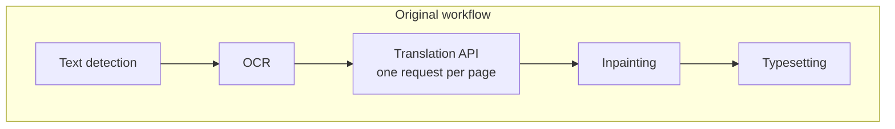
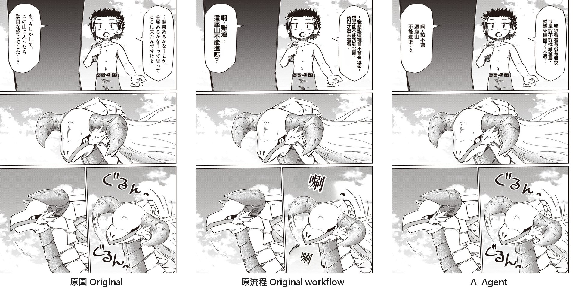
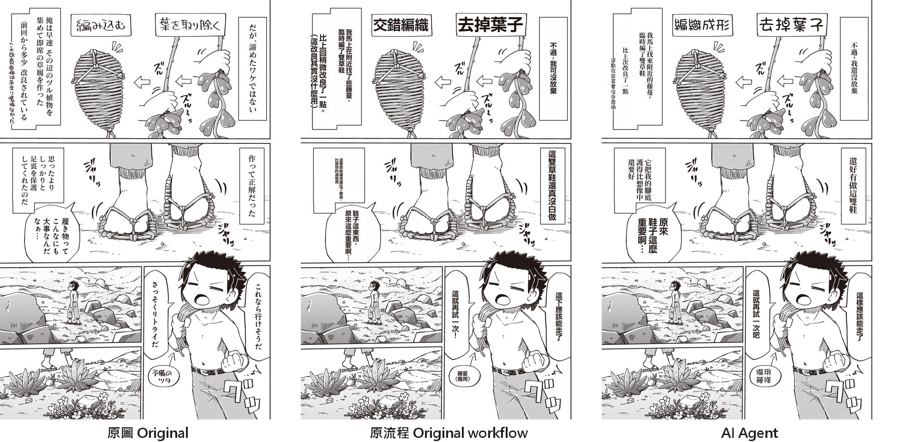
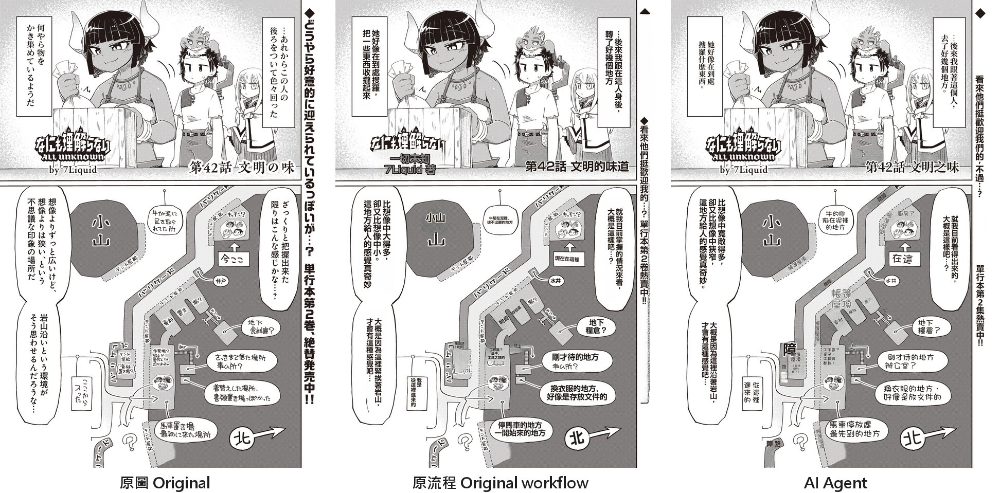
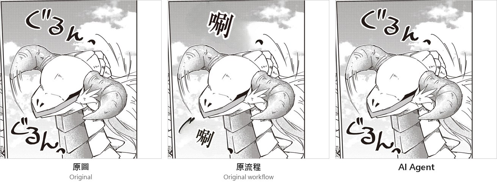
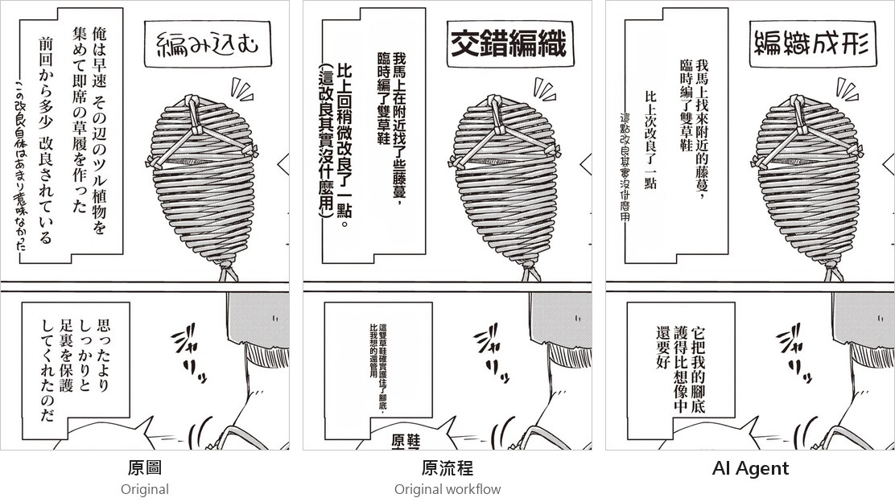
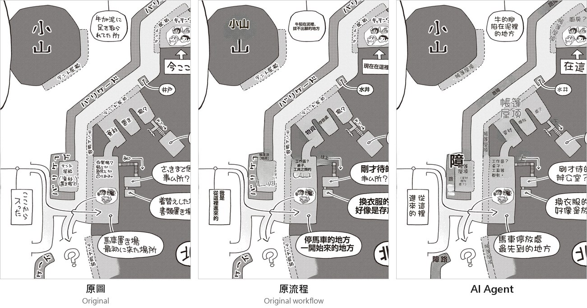
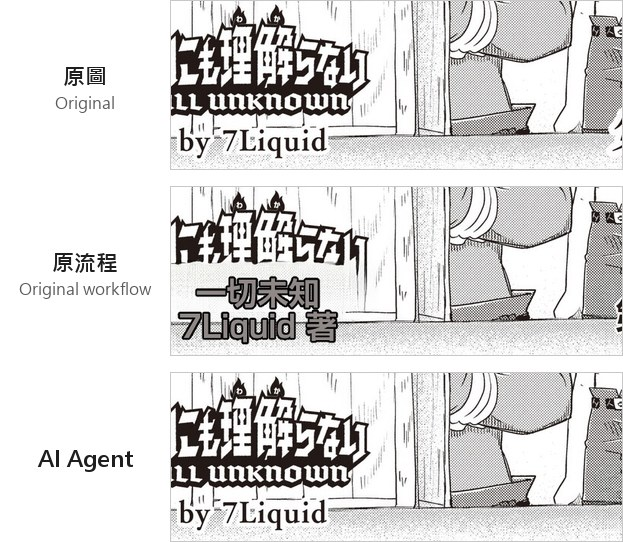
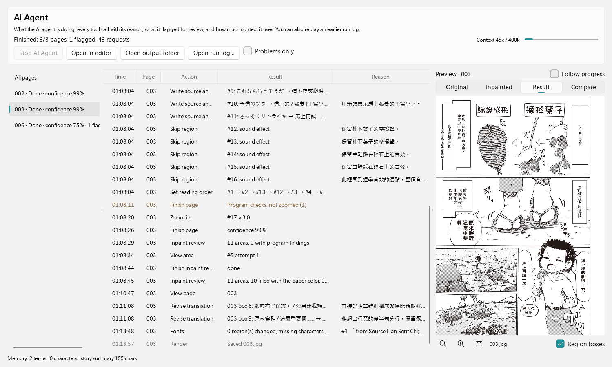

<div align="center">

# Manga Translator UI — AI Agent branch

**An AI agent reads, translates, and checks every page like a translator; the app inpaints and typesets**

[](https://github.com/hgmzhn/manga-translator-ui)
[](LICENSE.txt)

**Language**: [繁體中文](README.md) | English

</div>

This is a fork of [hgmzhn/manga-translator-ui](https://github.com/hgmzhn/manga-translator-ui). The `agents`
branch adds an **AI Agent workflow** next to the original one: a vision language model that calls tools reads
each page, adds text the detector missed, translates, and checks the layout, while sub-agents review the
inpainting and proofread. The pixel work (detection, inpainting, and typesetting) stays with the app. The branch
also merges a few upstream pull requests that aren't merged upstream yet, and fixes some issues (see
[Other changes](#other-changes)).

> **Note:** This branch is maintained by one person and isn't an official upstream release. Don't report
> problems with the AI Agent workflow to the upstream project.

## Summary

Here are the conclusions first; the details follow.

- **Results:** Three pages compare an easy, a normal, and a hard case. On a simple dialogue page the two workflows
  are about the same. On a normal page (narration, asides, and signs together), the AI Agent splits asides out of
  narration, keeps text at a normal size, and picks fonts close to the original lettering for signs and handwriting.
  On a hard page (a title page with a hand-drawn map), the original workflow misses most of the map labels; the AI
  Agent translates almost all of them but misplaces two.
  [See the comparison](#comparison-original-workflow-and-ai-agent)
- **Cost:** On real chapters the AI Agent uses about 430,000 prompt tokens per page (89% of them cached) and about
  2,900 output tokens, roughly 12 times the cost of the original workflow. Busier pages use more: about 140,000 for
  the easy page here and about 1.4 million for the hard one. [See token usage](#token-usage-time-and-cost)
- **Time:** Real chapters take about 2 to 2.5 minutes per page. Here the easy and normal pages took 4.5 minutes
  together and the hard page 13.5 minutes; the original workflow did all three in about 2.5 minutes.
- **Human review:** Anything the agent isn't sure about goes on a review list that you see on the AI Agent page and
  in the editor.

## Comparison: original workflow and AI Agent

The three images below are an easy, a normal, and a hard page. All three come from runs with the same version of the
app, the same GPT-series vision model on the
same OpenAI-compatible API, and the same prompt file for the work (with its glossary). The original workflow uses
the high-quality translator with one request per page; the AI Agent uses the default settings with proofreading
turned on. Each image shows, from left to right, the original page, the original workflow, and the AI Agent.

> The images are three pages of a Japanese commercial manga. The copyright belongs to its authors; the pages are
> shown only to illustrate the translation results.

### How the workflows differ

The original workflow sends a page's text to the translation API in one request, then inpaints and typesets the
translations it gets back. The AI Agent workflow lets the model work through each page step by step with tools.
Every step is logged, and the app checks the result of each step.

```mermaid
flowchart TD
    P["Preprocess<br>text detection, local OCR, font scan"] --> C["API check"]
    C --> R["Recall check<br>finds text the detector missed"]
    R --> T["Translation agent<br>reads, translates, and checks layout with tools"]
    T --> I["Inpaint review agent<br>checks and redoes each page's inpainting"]
    T --> PR["Proofreading agent (optional)<br>the whole chapter at once"]
    I --> F["Font check<br>replaces fonts that miss characters"]
    PR --> F
    F --> RD["Render"]
    T -.-> M[("Memory<br>glossary, characters, story summary")]
    M -.-> T
```





### Whole pages

#### Easy: a dialogue page

Chapter 32, page 9: two speech bubbles and sound effects drawn on the art. Both workflows translate well and lay the
text out properly, so the original workflow is good enough for pages like this. The difference is the sound effect:
the original workflow replaces "ぐるん" with "唰" and leaves part of the old strokes; the AI Agent leaves sound
effects drawn on the art as they are.



#### Normal: narration, asides, and signs together

Chapter 32, page 3: the original workflow merges the narration at the top left with the small aside next to it, and
shrinks the narration in the second panel to tiny text. The AI Agent puts the aside in its own box with a smaller
handwriting-style font, keeps the second narration at a normal size, and also gives the signs a handwriting-style
font.



#### Hard: a title page with a hand-drawn map

Chapter 42, page 1: the top half is the title page (the series logo, the author, and the chapter title); the bottom
half is a hand-drawn map. Its labels are small, some are written on a slant or over screentone, and one word is drawn
in two pieces.

- **Original workflow:** Text detection finds only 23 blocks of text. Four "バリケード" (barricade) labels, five
  "テント屋根" (tent roof) labels, "キッチン？" (kitchen?), and others on the map get no box and stay in Japanese.
  The logo's "ALL UNKNOWN" and the author line "by 7Liquid" are erased and rewritten as "一切未知 7Liquid 著".
- **AI Agent:** The recall check and the translation agent add the missing boxes, 37 in all, and every map label is
  translated; slanted labels keep their angle. The logo and the author stay as drawn; only the chapter title is
  translated.
- **AI Agent's weak spots:** A slanted "tent roof" label in the middle is set upright in large type, and the vertical
  "barricade" label on the left, which detection cut in two, comes out as one large and one small character. The
  inpaint review also lists 8 spots of screentone and dashed lines to check by hand; the page has 11 review items in
  all.



### Close-ups

These are the same areas, magnified.

| Easy: sound effects | Normal: narration and aside |
| :---: | :---: |
|  |  |

| Hard: map labels | Hard: logo and author |
| :---: | :---: |
|  |  |

## How the AI Agent works

The AI Agent workflow leaves understanding and decisions to the model and the pixel work to the app. The model reads
and changes each page's data through tools. The app checks every step and writes the results to the same
`*_translations.json` files as the original workflow, so you open and edit them in the editor as usual.

### The agents

A chapter (one folder) goes through the roles below. The recall check and the inpaint review run while the
translation agent works, to save time.

| Role | What it does | Default |
| --- | --- | --- |
| Recall check | Before each page, a separate model call looks for text the detector missed (handwriting, small text, text outside boxes). What it finds is snapped to the strokes and added as regions. The check for the next page runs while the translation agent works on the current one. | On |
| Translation agent | Looks at the whole page and the candidate regions, zooms in to read small or handwritten text again, and writes the source text, translation, line breaks, and reading order. It merges or splits regions, skips sound effects, and records glossary terms, characters, and a story summary. | On |
| Inpaint review agent | One separate conversation per page. The app first checks the inpainting (leftover text, broken lines, changes outside the mask), and boxes on a flat background are filled with the paper color. For areas with problems, the model adjusts the mask, protects art lines, and inpaints again, up to 3 times. | On |
| Proofreading agent | After translation, reads the whole chapter's translations at once and fixes only what's really wrong. | Off |
| Fonts | The translation agent may give narration, handwriting, or a sign an installed font that looks like the original lettering. At the end, a box whose font lacks a character gets the most similar installed font that has them all. Each change is checked by rendering the box with both fonts; a change that would move or resize the text isn't made. | On |

### Translation agent tools

The translation agent must call a tool at every step; it can't end a page with a plain text reply. These are the
main tools:

- **Looking:** `get_candidates` (the numbered page image and region list), `zoom` (a magnified crop with an A1–H8
  grid), `get_neighbors` (thumbnails of the previous and next pages), `local_ocr`, and `measure_bubble`.
- **Regions:** `add_region`, `merge_regions`, `split_region`, `skip_region`, `set_reading_order`, and
  `link_regions`.
- **Text:** `set_text`, `set_line_breaks`, and `set_font_style`.
- **Memory:** `glossary_search`, `glossary_upsert`, `character_get`, `character_upsert`, `story_summary_get`,
  `story_summary_update`, and `search_past_translations`.
- **Finishing:** `flag_for_review` (adds an item to the review list), `mark_page_done`, `budget_status`, and `undo`.

`mark_page_done` first runs program checks (for example, regions without a translation, small or handwritten text
that wasn't zoomed in on, and translations that don't follow the glossary) and computes the page's confidence from
the results. Pages below a confidence of 0.7 go on the review list.

### Memory and the work's prompt file

The translation agent records glossary terms, characters (translated name, gender, and way of speaking), and a story
summary. The chapters of a work share this memory: a chapter's first run starts with what the earlier chapters
learned, and adds its own part when it ends.

If you set a prompt file for the work in the translator settings (`translator.high_quality_prompt_path`, for example
`dict/<work>.yaml`), its instructions and glossary go into the agent's system prompt, and the app checks that the
translations follow the glossary. After each chapter, the names and terms the agent recorded and actually used are
added to that prompt file. Existing entries are never changed, and your own version is kept as `.bak`.

### Context management

One conversation holds at most 400,000 tokens. Once a request is larger than 300,000 tokens, the conversation is
compacted before the next page; older pages keep their text, and only the last 5 pages keep their images. Whole-page
images are scaled to at most 2048 px on the longest side (zoomed crops aren't). Each conversation has its own
`prompt_cache_key` so the API hits its cache as often as possible. Replies are streamed, so a proxy that cuts
connections that stay silent too long doesn't cut a long reply.

## Token usage, time, and cost

All numbers in this section come from real run logs (`manga_translator_work/agent/runs/*.jsonl`) and the usage the
API reported. "Prompt tokens" include the cached ones, which are usually billed at a lower price.

### These three pages

This table is the run behind the comparison images above. The easy and normal pages ran together as one chapter;
their proofreading and recall check (5 requests in all) are split evenly between the two pages.

| | Easy | Normal | Hard | All three |
| --- | ---: | ---: | ---: | ---: |
| Original workflow: requests | 1 | 1 | 1 | 3 |
| Original workflow: prompt tokens | 7,226 | 12,311 | 7,638 | 27,175 |
| Original workflow: cached | 5,248 | 0 | 5,248 | 10,496 (39%) |
| Original workflow: output tokens | 265 | 450 | 961 | 1,676 |
| AI Agent: requests | 6.5 | 11.5 | 33 | 51 |
| AI Agent: prompt tokens | 135,097 | 214,305 | 1,399,983 | 1,749,385 |
| AI Agent: cached | 99,136 (73%) | 155,968 (73%) | 1,170,560 (84%) | 1,425,664 (81%) |
| AI Agent: uncached prompt tokens | 35,961 | 58,337 | 229,423 | 323,721 |
| AI Agent: output tokens | 3,224 | 3,754 | 20,625 | 27,603 |

Time: the original workflow took 92 s for the easy and normal pages and 59 s for the hard page (each run includes
loading the models); the AI Agent took 4.5 min for the easy and normal pages and 13.5 min for the hard page (with
preprocessing).

The hard page used 10 times the prompt tokens of the easy page: the translation agent made 14 requests to add, fit,
and lay out boxes, and the inpaint review made 15 requests to redo the screentone and dashed lines on the map.

The AI Agent's prompt tokens per page over these three pages, by role (most of them come from the hard page):

| Role | Prompt tokens per page | Share |
| --- | ---: | ---: |
| Translation agent | about 319,000 | 55% |
| Inpaint review agent | about 228,100 | 39% |
| Proofreading agent | about 27,400 | 5% |
| Recall check | about 8,600 | 1% |

### Real chapters

This table averages 8 full chapter runs (90 pages); some of these chapters had proofreading turned on. These runs
happened before whole-page images were scaled to 2048 px.

| Item | Per page |
| --- | ---: |
| Requests | 12.5 |
| Prompt tokens | 426,105 |
| Cached | 89% |
| Uncached prompt tokens | 48,412 |
| Output tokens | 2,867 |
| Time (running alone) | about 2–2.5 min |

Prompt tokens by role: translation agent 75% (5.3 requests per page, 94% cached), inpaint review 19% (5.8 requests
per page, 76% cached), proofreading 4%, and recall check 2%.

### Estimating the cost

You can estimate the cost like this:

```text
cost per page = uncached prompt tokens × input price
              + cached prompt tokens × cached price
              + output tokens × output price
```

The example below uses **assumed prices**: $2 per million input tokens, $0.20 per million cached tokens, and $8 per
million output tokens. Replace them with the real prices of your model and provider.

| | Original workflow | AI Agent |
| --- | ---: | ---: |
| Easy page | about $0.007 | about $0.12 |
| Normal page | about $0.028 | about $0.18 |
| Hard page | about $0.014 | about $0.86 |
| Real chapters, per page (90 pages) | — | about $0.20 |
| A 12-page chapter | about $0.20 (average of the three pages above) | about $2.3 (real-chapter average) |

> **Note:** The cost depends heavily on caching. If your API doesn't cache prompts, every AI Agent prompt token is
> billed at the full price: about $0.88 per page on real chapters with the assumed prices above.

### Using fewer tokens

You find these settings on the **AI Agent** tab of the **Settings** page:

- **Proofreading** (`proofread`) is off by default; turning it on adds about 4–7% prompt tokens.
- **Inpaint review** (`inpaint_review`) takes 19–39%. Without it, the app keeps the first inpainting and doesn't
  check or redo it.
- **Recall check** (`recall_pass`) takes only 1–3% and adds text the detector missed, so we recommend keeping it.
- **Double read** (`double_read`) set to `none` zooms in less often, but small and handwritten text is misread more
  often.
- **Image detail** (`image_detail`) set to `low` cuts image tokens a lot, but small text becomes hard to read.
- **Pages that keep images** (`keep_images_last_n_pages`) set lower makes each request smaller.

## Usage

This section explains how to use the AI Agent workflow from the desktop app and the command line, and how to handle
the results.

### Requirements

The AI Agent needs an **OpenAI-compatible API that accepts images and tool calls (function calling)**. This branch
has only been tested with GPT-series vision models. An API with prompt caching costs much less.

The AI Agent uses the same API settings as the OpenAI translators (`OPENAI_API_KEY`, `OPENAI_API_BASE`,
`OPENAI_MODEL`, and their numbered candidates), so API key rotation applies too. To give the agent a different model,
enter the model name on the **AI Agent** tab of the **Settings** page.

### Desktop app

Follow these steps to run an AI Agent translation:

1. In **Settings**, set up an OpenAI-compatible API and, if you want, a prompt file for the work.
2. On the **Translation** page, set **Translation Workflow Mode** to **AI Agent Workflow**.
3. Add the chapter folders you want to translate, and click **Start Agent Workflow**.
4. Follow the run on the **AI Agent** page: every tool call with its reason, the items flagged for review, the
   context use, and a preview before and after inpainting.
5. When the run ends, click **Open in editor**. The editor's **AI Agent** tab lists the page's review items, skipped
   boxes, and inpainted areas; picking one selects its box in the editor. **Restore this box** adds a skipped box
   back to the page, and **Use this attempt** switches an area to another inpainting attempt.



You can also replay an earlier run on the AI Agent page with **Open run log…**.

### Running a chapter again

When you start a chapter the AI Agent already worked on, the app asks what to do first:

| Option | What it does |
| --- | --- |
| Redo the steps not done | Reruns only the steps that failed last time (for example, an inpaint review or proofreading that failed when the API usage limit ran out), then renders those pages again. |
| Check again | Doesn't detect or translate again. Keeps the translations, looks at the finished pages again with the current rules, and inpaints again only where something changed. The boxes you changed in the editor are locked. |
| Only the pages not done | Leaves finished pages and pages translated elsewhere alone. |
| Redo all | Detects and translates every page again, and overwrites the translations and JSON files. |

Before anything is overwritten, the app backs up the JSON files, inpainting results, and output images to
`manga_translator_work/agent/backups/`. If a run stops or fails partway, the unfinished pages go back to how they
were before the run.

### Command line

Set `cli.agent_workflow` to `true` in the config file, and the `local` mode uses the AI Agent workflow:

```bash
python -m manga_translator local -i <chapter folder> --config <config.json>
```

Two more options work on chapters that already ran (they use the AI Agent even with `cli.agent_workflow` off, and
don't support `--subprocess`):

- `--agent-revise`: checks the chapter again, like **Check again** in the desktop app.
- `--agent-redo`: redoes the steps that weren't done last time.

### Main settings

All settings are in the `agent` section of the config file, and the common ones are also on the **AI Agent** tab of
the **Settings** page.

| Setting | Default | Description |
| --- | --- | --- |
| `model` | empty | The agent's model; empty uses `OPENAI_MODEL`. |
| `reasoning_effort` / `review_reasoning_effort` | empty | Reasoning effort for translation and proofreading / for the recall check and inpaint review; empty sends none, so the model's default applies. |
| `max_context_tokens` | 400000 | The limit of one conversation. |
| `compact_threshold_tokens` | 300000 | Compacts the conversation before the next page once a request is this large. |
| `keep_images_last_n_pages` | 5 | How many recent pages keep their images. |
| `page_image_max_side` | 2048 | Longest side of whole-page images; 0 sends them at full size. |
| `max_steps_per_page` | 40 | Model calls allowed per page. |
| `image_detail` | `high` | Image detail: `high` or `low`. |
| `double_read` | `small_or_handwritten` | Which regions get a second, zoomed read: `all`, `small_or_handwritten`, or `none`. |
| `recall_pass` | `true` | The recall check. |
| `inpaint_review` | `true` | The inpaint review. |
| `fill_flat_areas` | `true` | Fills boxes on a flat background with the paper color. |
| `proofread` | `false` | Proofreads the whole chapter. |
| `choose_fonts` / `fix_missing_glyphs` | `true` | The agent picks fonts / fonts that miss characters are replaced. |
| `low_confidence_threshold` | 0.7 | Pages below this confidence go on the review list. |
| `stream_requests` | `true` | Receives replies as a stream. |
| `share_memory` | `true` | The chapters of a work share their memory. |
| `update_work_glossary` | `true` | Adds new terms to the work's prompt file. |
| `revise_lock_user_edits` | `true` | Locks the boxes you changed in the editor when a chapter is checked again. |
| `extra_instructions` | empty | Extra instructions added to the system prompt. |

## Limitations

The AI Agent workflow doesn't solve everything. Keep these limits in mind:

- **Cost and time:** It uses about 25 times the tokens of the original workflow per page, costs about 12 times as
  much (with caching), and takes much longer.
- **Human review is still needed:** The agent makes mistakes, such as setting a short line too small. Check the
  review list and the results before you publish anything.
- **Model quality:** The results depend heavily on the model's vision and tool-calling skills. Only GPT-series vision
  models have been tested.
- **API usage limits:** When the usage limit runs out, the page renders with what it has and the steps that weren't
  done are recorded. You can redo them later with **Redo the steps not done** or `--agent-redo`.
- **Memory:** The inpaint review makes several inpainting candidates on your computer and can fail when memory runs
  low (you can redo it the same way).

## Other changes

Besides the AI Agent workflow, this branch has these changes.

**Merged upstream pull requests (not merged upstream yet):**

- [#297](https://github.com/hgmzhn/manga-translator-ui/pull/297): the PP-OCRv6 Manga v0.2 text detector (pipi9178).
- [#320](https://github.com/hgmzhn/manga-translator-ui/pull/320): pasting a region's style also copies its stroke
  settings (jscmp4).
- [#334](https://github.com/hgmzhn/manga-translator-ui/pull/334) and
  [#335](https://github.com/hgmzhn/manga-translator-ui/pull/335): fixes for the editor's rich text and brush sizes
  (LevKno).
- [#338](https://github.com/hgmzhn/manga-translator-ui/pull/338),
  [#339](https://github.com/hgmzhn/manga-translator-ui/pull/339), and
  [#340](https://github.com/hgmzhn/manga-translator-ui/pull/340): fixes for API tests, streamed translations, and
  punctuation at vertical line breaks (sansenjian).

**Performance and fixes:**

- Fixes a slow cuDNN path, restores OpenCV threads, and runs panel detection in memory.
- API OCR no longer retries blank boxes forever; fixes for YAML prompt files in the editor and a runaway text canvas.
- Pages that share a file name stem get their own work files and output images; exports never overwrite the source.
- An archive imported again keeps the work of its pages; a PDF page with text or several images is rendered whole.
- The command line's `--subprocess` mode keeps chapter folders and honors its memory limit.

**Interface:**

- The Traditional Chinese interface uses Taiwan terminology.
- Before you leave the editor, close the app, or remove a page, the editor saves and exports the open page as your
  settings say; it asks first if another program changed the file.
- When the app runs another branch or has local commits, the built-in update doesn't switch it back to upstream
  `main`.

## Installation

This branch installs like upstream; the code just needs to be on the `agents` branch. The AI Agent workflow doesn't
need extra Python packages.

1. Install upstream by following its
   [quick start](https://github.com/hgmzhn/manga-translator-ui/blob/main/README_EN.md#-quick-start) (for example,
   the Windows portable package), and check that it starts.
2. In the program folder, switch to this branch. In the Windows portable package, you can use
   `PortableGit\cmd\git.exe` from the folder in place of `git`:

   ```bash
   git remote add agents https://github.com/HHim8826/manga-translator-ui-agent.git
   git fetch agents
   git checkout -B agents agents/agents
   ```

3. Start the app as usual.

To update later, run `git pull agents agents` in the same folder.

> **Warning:** Don't use the app's built-in **Update Now** or the installer menu's update; they're made for
> upstream `main`. This branch guards against them overwriting another branch, but `git pull` is the safest way to
> update.

## Acknowledgements

This branch builds on the work of many projects and contributors:

- [hgmzhn/manga-translator-ui](https://github.com/hgmzhn/manga-translator-ui): the upstream project, with the
  interface, editor, and full translation pipeline.
- [zyddnys/manga-image-translator](https://github.com/zyddnys/manga-image-translator): the core translation engine.
- The authors of the upstream pull requests listed above: pipi9178, jscmp4, LevKno, and sansenjian.
- The models, OCR, and reference projects upstream uses; see the full list in
  [upstream's acknowledgements](https://github.com/hgmzhn/manga-translator-ui/blob/main/README_EN.md#-acknowledgements).

If this tool helps you, consider
[supporting the upstream author](https://github.com/hgmzhn/manga-translator-ui/blob/main/README_EN.md#support-author).

## License

The code is open source under the **GPL-3.0** license; see [LICENSE.txt](LICENSE.txt).

**Model license:** The MangaJaNai/IllustrationJaNai super-resolution model weights this project supports are licensed
under **CC BY-NC 4.0** (Attribution-NonCommercial) and are for non-commercial use only. Model source:
[MangaJaNai](https://github.com/the-database/MangaJaNai).

## Special notice

This project is for technical demonstration and personal learning only, and isn't legal, business, or compliance
advice. When you install, configure, call, or distribute its features, you're responsible for following your local
laws, platform rules, content licenses, and third-party terms of service.

- You're solely responsible for everything you do with this project and its consequences, including processing,
  publishing, sharing, redistributing, and commercial use of content.
- You must make sure your input, output, and data sources are properly licensed, and you must not use the project to
  infringe copyright, trademarks, privacy, likeness, or other rights.
- Using the project for anything illegal is strictly prohibited, including piracy, unauthorized mass scraping and
  reposting, bypassing platform restrictions, fraud, and defamation.
- The project depends on third-party models, APIs, data, and libraries. Their availability, accuracy, stability,
  cost, risk controls, and compliance are their providers' responsibility, and you bear the related risks and costs.
- To the extent the law allows, the authors and contributors aren't liable for any direct or indirect loss caused by
  using or being unable to use this project.

Assess the risks before you use the project; continuing to use it means you've read, understood, and agreed to this
notice.
